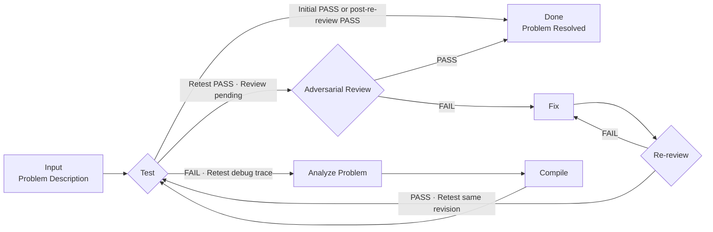

# AI Agent Self Workflow

Use the same Test node for each run. When Re-review passes, retest that exact revision. A PASS goes directly to Done. A FAIL returns to Analyze Problem. Any subsequent code change needs test and review evidence for the new revision.
